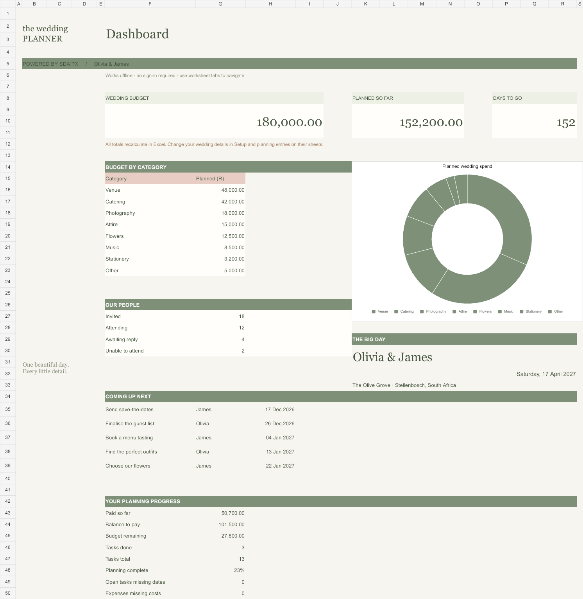

# PayteqChallange

## From a wedding planner to a digital product business

**A candidate challenge in spreadsheet engineering, product thinking, business design and creative promotion.**

| Item | Detail |
| --- | --- |
| Project owner | Johan Botha |
| Handout | Wednesday, 18 November 2026, morning |
| Submission deadline | **Thursday, 19 November 2026, 12:00 SAST (UTC+02:00)** |
| Required | A working Excel template, validation evidence, a presentation and promotional concepts |
| Optional | A small software mock-up or prototype |
| AI | Permitted, with disclosure and verification |
| Reference pack | [21 Excel worksheet images and gallery](references/README.md) |

> **Ownership and assessment-only notice:** This is Johan Botha's project. The supplied brief, screenshots, visual assets and other owner-provided materials are shared for this candidate assessment. Public access is not permission to claim ownership, hijack, rebrand, resell, commercially launch or sublicense these materials or an adaptation of them. Candidate adaptations are permitted for completing and submitting this assessment under the [LICENSE](LICENSE). No commercial rights or ownership transfer are granted. GitHub's platform rights and applicable law remain unaffected.



## The opportunity

For this exercise, assume the starting product is a wedding-planning Excel template that is already selling through a marketplace such as Etsy. It is a digital product: create and package the template once, advertise it, and deliver a downloadable copy to each purchaser. There is no need to manufacture a new workbook for every sale, although marketing, support, updates and selling costs still require work.

You have been given images of a wedding-planning Excel workbook. **Turn these references into a working Excel product, then explain how you would develop the idea into a stronger business.** You are being assessed as both a creator and someone who can make practical commercial and technical decisions.

This is a scenario, not a claim about verified sales volumes, revenue, pricing or customer numbers. No private implementation, existing workbook, backend, customer database or financial information is supplied. Do not assume an undisclosed system exists or try to access one.

### Two different buyers

> A person or couple may buy the planner for their own wedding and use one copy for themselves. A wedding planner or agency may buy it for professional use, keeping a separate copy for each client they serve.

Explain how these two buyers change the product, pricing, packaging, support and permitted usage. Do not assume a personal-use purchase automatically grants unlimited professional use: propose clear terms and explain why they make commercial sense.

Consider the complete experience: discovery, purchase, download, first use, ongoing planning, completion of the wedding, and what happens next.

## 1. Build the Excel product — required

Create an original, usable Excel workbook from the [reference screenshots](references/README.md). Translate the planning experience into spreadsheet functionality; do not paste screenshots into cells and call it a template.

Cover all **21 planning areas** in the reference pack. You may combine related areas where that improves the workbook, but include a clear screenshot-to-sheet mapping so coverage is easy to assess. Use your own structure, formulas and design decisions. Pixel-perfect reproduction is not required.

Your workbook must:

- Open, edit, calculate and save as a standalone `.xlsx`, without an account, internet connection, external database, paid service or macro enablement.
- Include a concise **Start here** guide, clear worksheet names/navigation, and a distinction between editable inputs and calculated cells.
- Handle wedding setup, dates and currency; budget and payments; guests/RSVPs/seating; tasks/calendar/itinerary; suppliers/venues/contacts; and the other referenced planning areas.
- Calculate useful summaries from the underlying inputs. Charts and dashboards must reflect the data rather than being decorative images or hardcoded totals.
- Provide suitable validation and readable date, currency and status formatting. Handle blank rows and normal input changes without broken formulas or misleading errors.
- Expand sensibly when records are added. State any deliberate capacity limits.
- Include fictional demonstration data, plus a clean reusable starting point or clear, safe reset instructions that preserve formulas.
- Support **Save As** copies for different clients. Demonstrate two independent client files with different details and no cross-workbook links or data leakage.
- Be readable for everyday users, including useful print/PDF layouts for at least the budget and wedding-day itinerary.

Use actual worksheet tabs, tables and appropriate Excel controls. If a referenced feature is simplified or cannot be implemented sensibly in Excel, explain the limitation and your alternative. Do not provide decorative controls that imply a working feature when none exists.

Specify the Excel version/platform you actually tested. Do not claim compatibility with versions you did not use. Optional automation or a software prototype does not replace the standalone workbook.

### Prove the workbook works

Include `validation.md` with inputs, expected results, actual results, test environment and any limitations. Test the workbook itself, not only generated formula strings. Show recalculation evidence from Excel or a compatible spreadsheet engine; identify which one you used and any Excel-specific behaviour still unverified.

At minimum, demonstrate:

| Test | Evidence expected |
| --- | --- |
| Budget and payments | Change costs/payments; totals, outstanding payments and remaining budget update correctly. For example, budget 5,000; costs 1,000 + 2,500; payments 400 + 1,000 gives planned 3,500, paid 1,400, outstanding 2,100 and remaining budget 1,500. |
| Guests and seating | Change RSVP/table assignments; counts and seating views update consistently. |
| Tasks and dates | Change wedding date, due dates and completion status; dependent planning views update as designed. |
| Food and drinks | Verify quantity × unit cost and the overall menu total. |
| Growth and blank input | Add records and clear optional inputs; totals include new data and formulas remain usable. |
| Persistence | Save, close and reopen; entered information and calculations remain correct. |
| Independent client copies | Save two client workbooks; change one and confirm the other is unaffected. |
| Clean start and print | Show a usable clean template and readable budget/itinerary output. |

Use your own additional tests. A failed test is more useful when honestly explained than a claim that everything works without evidence.

## 2. Expand the business — required

Present a coherent recommendation, not a list of every feature that could exist. Address the following questions and make your own decisions.

### Customers, positioning and monetisation

- What problem does each buyer pay to solve? Why choose this product rather than a blank spreadsheet or an alternative tool?
- Would you offer personal, professional, agency or other editions? What is included, what can be reused for clients, and what must not be redistributed?
- Which revenue opportunities would you prioritise: the template itself, complementary downloads, professional licences, customisation, services, physical products or recurring features? Explain the value and trade-offs rather than assuming every feature needs a subscription.
- What pricing would you test? Label your assumptions, currency and proposed terms. Show a simple worked revenue/cost example including selling fees, promotion, support and ongoing operation where relevant.
- How would you measure whether the idea is working: acquisition, conversion, support burden, repeat purchases or retention? Choose useful measures and explain the decisions they inform.

You may research examples and alternatives. Cite sources and access dates, distinguish facts from assumptions, and check current marketplace/platform rules before relying on them. Do not invent sales statistics or imply that a competitor's figures are verified.

### Is there a core business control system?

Decide whether this business needs an internal control system, when it needs it, and **what, why and how** it should control. Explain what can initially be handled manually or with existing tools, and what merits custom software.

Cover the complete proposed operating model: orders and fulfilment, customers and professional clients, product versions, usage permissions, support and updates, payment/billing records, communication, reporting and administration. Identify which parts you would build, buy or integrate and why.

Show a simple system diagram, the main records and their ownership, key user/admin journeys and important integration boundaries. Explain permissions, separation of client information, reliability, maintenance and operating cost at an appropriate level. Discuss billing and ongoing access only if your proposed offering needs them; explain what a purchaser retains if an optional recurring service ends.

You choose the architecture and technology. There is no hidden requirement to reproduce a private system, and a diagram does not need to become a fully implemented production platform for this assessment.

### Template, desktop, web or mobile?

Evaluate the role of each option below. You do not have to recommend building them all.

| Option | What to explain |
| --- | --- |
| Excel/downloadable template | What should remain simple, standalone and reusable? How are updates delivered? |
| PC desktop application | Who benefits beyond Excel, what extra capability justifies it, and what distribution/support costs follow? |
| Web application | What online workflow or shared experience earns its operating cost? |
| Mobile application | What meaningful on-the-go use case justifies a mobile product? |
| Professional/agency workflow | How would multiple clients, collaboration, branding and reusable planning processes work? |

Compare the alternatives, choose a sensible starting point, identify what you would deliberately defer, and propose a phased 30/60/90-day plan. Explain dependencies, effort, risks and how you would validate demand before a large build.

A small prototype or clickable mock-up is welcome, but **optional**. A strong documented proposal can earn full marks for this part. Any demonstration must clearly distinguish working behaviour, simulated behaviour and future ideas.

## 3. Promote the idea creatively — required

Show how you would take an already-selling idea and improve its presentation, reach and conversion.

Consider marketplace listings and product previews, flyers, printable notebooks/workbooks, planner inserts, social advertisements, short video concepts, bundles, partnerships with wedding professionals and other channels you can justify. Explain what you would create, for whom, where it would appear and how you would measure it.

Submit at least:

1. **One flyer concept** with a clear audience, promise and call to action.
2. **One social/digital ad concept** with sample visual/copy, placement and destination.
3. **One notebook, printable or bundle concept**, showing how it complements the core product and whether it is a download, physical item or both.

These may be simple mock-ups inside the presentation or separate files. Show actual sample creative work, not just the words “make a flyer” or “run ads.” Explain the relationship between the creative, the customer journey and the proposed offer. Use original or appropriately licensed assets and identify third-party sources. Do not publish a live listing, run paid advertising, contact customers or incur costs for this exercise.

## 4. Explain the project in a presentation — required

Provide a PDF presentation, preferably around **10–15 well-structured slides**, telling the complete story:

- Your interpretation of the opportunity and the two buyer types.
- The working Excel product, coverage, demonstration and validation results.
- Your proposed offers, licensing, monetisation and commercial assumptions.
- The operating/business control system and proposed architecture.
- Your platform choices, trade-offs and phased roadmap.
- Your flyer, ad and notebook/bundle concepts and launch plan.
- Risks, research sources, limitations and recommended next steps.

You may also supply an editable deck or a structured supporting document. No software prototype is required: the wider system may remain a well-explained documented concept. The Excel deliverable must still work.

AI tools may assist with research, formulas, code, visuals and presentation. Include a short `ai-usage.md` stating which tools you used, what you used them for, what you personally changed and how you verified the results. You must be able to explain the submission. Do not upload confidential materials into AI tools without permission or submit outputs you have not checked.

## Deliverables and submission

Place your work in a folder such as:

```text
submissions/your-name/
  README.md                    # What is included, how to open it, assumptions and time spent
  workbook/
    Wedding-Planner.xlsx
    Client-A.xlsx
    Client-B.xlsx
  presentation/
    Proposal.pdf
  creative/                    # Flyer/ad/notebook assets, if separate from the deck
  validation.md
  ai-usage.md
  prototype/                   # Optional; include setup instructions if supplied
```

For the workbook, state which file is the clean master and which are demonstrations. In your submission README include a screenshot-to-sheet coverage map, dependencies, known limitations, sources/asset credits and a brief explanation of your most important decisions. If no AI was used, say so in `ai-usage.md`.

### GitHub workflow

This repository is public. A public repository does **not** automatically give candidates permission to push branches directly to it.

1. Fork this repository to your own GitHub account.
2. Create a branch such as `candidate/your-name` in your fork.
3. Add your submission under `submissions/your-name/`, retaining the original brief, reference pack and licence notices.
4. Commit and push your branch, then open a pull request against this repository's `main` branch **before Thursday, 19 November 2026, 12:00 SAST**.
5. In the pull request, link your submission README and identify the workbook and presentation. State the tested Excel environment and any incomplete items.

If the owner explicitly grants collaborator access, you may instead push a candidate branch in this repository and open a pull request. Do not request or use access to any private project to complete this challenge.

Your fork, branch and pull request may be publicly visible. Do not upload passwords, tokens, real customer/client information, CVs, private contact details or any other confidential material. If a private assessment submission is necessary, agree on that route with the owner before uploading.

Deadline means the submission/PR must be available for review by that time. Clarify genuine blockers before the deadline; document assumptions rather than waiting for hidden implementation details.

## How the work will be assessed

| Area | Weight | What strong work demonstrates |
| --- | ---: | --- |
| Working Excel product and validation | 40% | Useful standalone workbook, complete coverage, correct calculations, reusable client copies and credible test evidence. |
| Product and commercial thinking | 20% | Clear customer segmentation, defensible offers/licensing, realistic monetisation and stated assumptions. |
| Business operations and system design | 15% | A coherent operating model, justified build/buy decisions, practical architecture and sensible platform trade-offs. |
| Promotion and creative execution | 15% | Audience-specific flyer/ad/notebook concepts connected to a measurable acquisition plan. |
| Presentation and submission quality | 10% | Clear narrative, organised files, honest limitations, research/asset credits and transparent AI use. |
| **Total** | **100%** | |

Prioritise a working, understandable product and reasoned decisions. Optional software does not automatically earn extra credit or compensate for a broken workbook. We are interested in your judgement, creativity and ability to turn a reference into something a real buyer could use.

## Ownership, licence and boundaries

This challenge is **not an open-source release** of the underlying project. Read the [assessment-only LICENSE](LICENSE) before using the materials. You may complete the exercise and submit your adaptation; you may not remove ownership notices, claim the owner's supplied work as yours, or independently commercialise these materials or adaptations without written permission.

Original candidate contributions remain the candidate's unless a separate written agreement says otherwise. Submission permits the owner to review and assess the work; it does not by itself transfer all candidate IP or grant permission to ship the candidate's original work commercially. This also does not transfer ownership of the supplied project to the candidate.

The screenshots are provided to define the exercise, not as proof of sales, as a source of private credentials, or as permission to access a running system. Any fictional contact details are demonstration data. Do not infer that screenshot totals, old dates or displayed statuses are business facts.

**Questions, assumptions and prioritisation are part of the assessment. Build the spreadsheet. Explain the business. Show how you would take it further.**

Licensing background: [GitHub repository licensing and public-fork rights](https://docs.github.com/en/repositories/managing-your-repositorys-settings-and-features/customizing-your-repository/licensing-a-repository); [WIPO copyright scope](https://www.wipo.int/en/web/copyright/protection). These references do not turn the assessment licence into an open-source licence.
