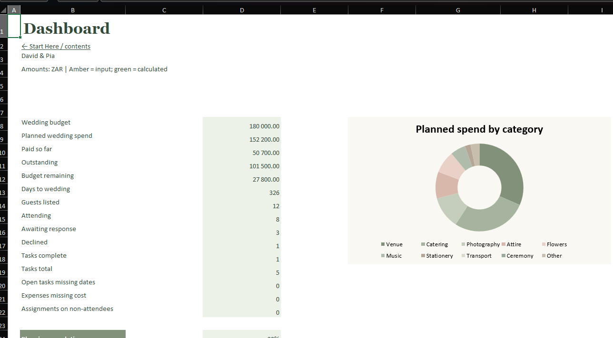
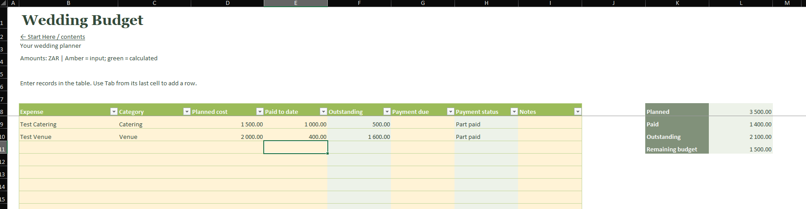
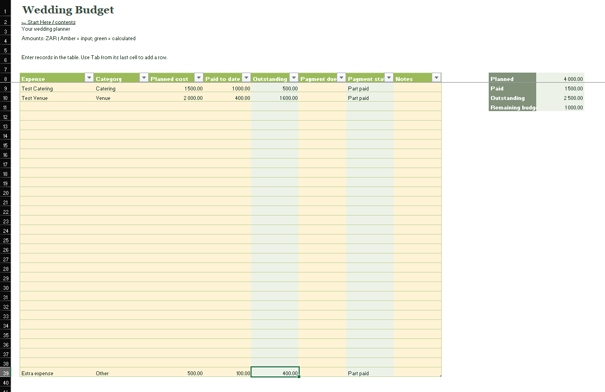
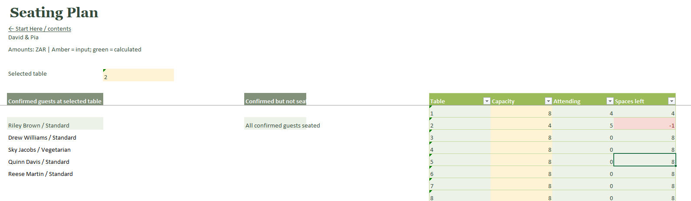
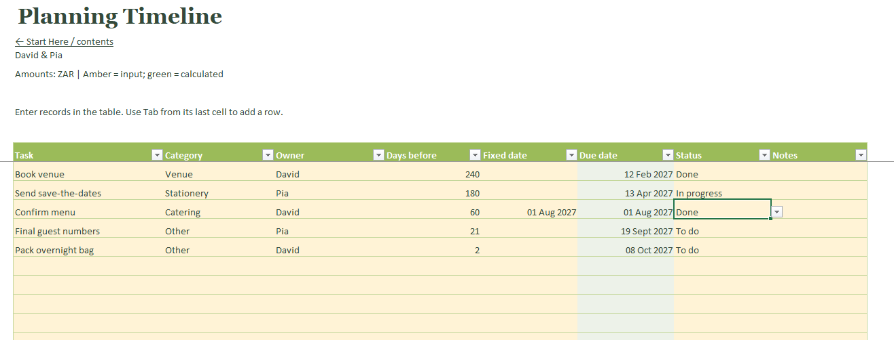
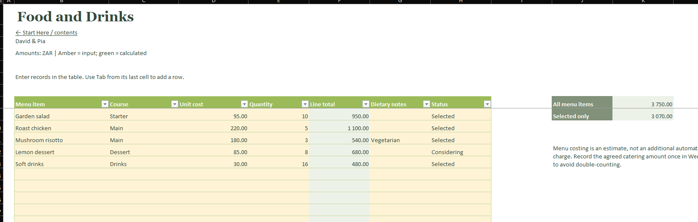

# Wedding Planner — Validation

## Environment and method

- Operating system: Windows.
- Spreadsheet application: Microsoft Excel for Microsoft 365, 64-bit.
- Excel version: 2610, Build 16.0.20527.20196.
- Generator: Python 3.15.2 with XlsxWriter 3.3.1.
- Tester: Candidate.
- Method: Manual interaction with generated workbooks in Excel, including
  changed inputs, recalculation, table growth, saving/reopening, independent
  client copies and print/PDF inspection.

XlsxWriter generates formulas but does not calculate them. The results below
were checked by the candidate in Excel, not inferred solely from generated
formula strings.

No compatibility claim is made for Excel versions or platforms not tested.

## Workbook files

| File | Purpose |
|---|---|
| `workbook/Wedding-Planner.xlsx` | Clean reusable master |
| `workbook/Client-A.xlsx` | Fictional Alex and Jordan demonstration |
| `workbook/Client-B.xlsx` | Fictional Sam and Taylor demonstration |

Functional mutation tests were performed in disposable copies so the master
and demonstration files could retain their intended starting data.

## Initial opening and recalculation

The candidate confirmed that the initial workbooks opened and calculated.

Client A displayed:

- Planned wedding spend: 152,200.
- Paid to date: 50,700.
- Outstanding: 101,500.
- Remaining wedding budget: 27,800.
- Dynamic seating names without formula errors.
- Menu total: 3,560.
- Selected-menu total: 2,880.
- Planning Timeline due dates displayed as dates.

## Test results

### A. Budget, payments and growth — PASS

Inputs:

- Wedding budget: 5,000.
- Expense 1: planned 1,000; paid 400.
- Expense 2: planned 2,500; paid 1,000.

Expected and candidate-confirmed actual results:

| Measure | Expected | Actual |
|---|---:|---:|
| Planned spend | 3,500 | 3,500 |
| Paid | 1,400 | 1,400 |
| Outstanding | 2,100 | 2,100 |
| Remaining budget | 1,500 | 1,500 |

A new row was added by expanding the native Excel Table, with planned cost
500 and payment 100.

| Measure | Expected | Actual |
|---|---:|---:|
| Planned spend | 4,000 | 4,000 |
| Paid | 1,500 | 1,500 |
| Outstanding | 2,500 | 2,500 |
| Remaining budget | 1,000 | 1,000 |

Clearing optional notes and the payment date did not change the totals.

### B. Guests and seating — PASS

Starting Client A data:

- Attending: 8.
- Awaiting reply: 3.
- Declined: 1.
- Table 1 confirmed guests: 4.
- Table 2 confirmed guests: 3.
- Confirmed but unassigned: 1.

Actions and candidate-confirmed results:

1. Assigned Quinn Davis to table 2:
   table 2 increased to 4 and no confirmed guests remained unassigned.
2. Changed Reese Martin to Attending and assigned table 2:
   attending increased to 9, awaiting reply decreased to 2,
   and table 2 increased to 5.
3. Reduced table 2 capacity to 4:
   spaces left became -1 and the capacity warning appeared.

### C. Tasks, dates and calendar — PASS

Actions and candidate-confirmed results:

1. Changed the wedding date from 10 October 2027 to 17 October 2027.
   Wedding-relative task deadlines moved forward seven days.
2. Confirm menu moved from 20 July to 27 July 2027.
3. Entered a fixed-date override of 1 August 2027.
   The task due date became 1 August 2027.
4. Selected August 2027 in Calendar.
   The task appeared in the 1 August count.
5. Marked the task Done.
   The calendar's open-task count decreased by one and Dashboard tasks
   complete increased from 1 to 2.

Intended behaviour: manually entered payment deadlines and itinerary times
do not automatically move when the wedding date changes.

### D. Food and drinks — PASS

Changed Garden salad quantity from 8 to 10, keeping unit cost at 95.

| Measure | Expected | Actual |
|---|---:|---:|
| Garden salad total | 950 | 950 |
| All menu items | 3,750 | 3,750 |
| Selected items | 3,070 | 3,070 |

Clearing optional dietary notes did not change the totals.

### E. Persistence — PASS

Saved, closed and reopened the modified budget test workbook.

The candidate confirmed that entered records and the updated totals
remained correct: planned 4,000; paid 1,500; outstanding 2,500;
remaining budget 1,000.

### F. Independent client copies — PASS

Changed Client A's partner name and wedding budget in disposable copies,
then saved, closed and reopened the files.

The candidate confirmed:

- Client B retained its own details.
- Changes to Client A did not affect Client B.
- No external workbook links were found in the link check.

### G. Clean start and print output — PASS

The candidate confirmed:

- The clean master had blank personal/planning records.
- Initial totals and unset-budget behaviour were usable.
- A temporary expense could be entered without formula errors.
- Wedding Budget and Wedding Itinerary print/PDF output was readable,
  with important content not cut off.

## Regression defect and correction

A formatting revision introduced an Excel repair prompt:

> Repaired Records: View from /xl/worksheets/sheet2.xml part.

The affected worksheet was Dashboard.

The generator had called `freeze_panes(0, 0)` after applying a shared
freeze-pane configuration. The fix excluded Dashboard from the shared
freeze-pane call and removed its zero-position freeze call.

The candidate regenerated the files and confirmed successful opening and
retesting without the repair prompt.

Other presentation improvements included whole-number counts, a more
compact dashboard chart and targeted date formatting.

The final Start Here wording was updated to state the tested environment;
the candidate confirmed that the revised guide text was readable.

## Known limitations

- Modern Excel is required for FILTER and SORT.
- Seating supports 20 predefined tables.
- Photo Gallery contains four initial panels.
- Input validation is pre-applied through worksheet row 5,000.
  Extend it if exceeding that range.
- Formula cells are colour-coded but not protected against editing.
- Excel paste operations can bypass validation.
- Dynamic lists need unobstructed space to expand.
- Print areas should be reviewed after significant record growth.
- Each workbook uses one currency; changing its label does not convert values.
- Decimal/thousands separators depend on Excel/application settings.
- Expenses use cumulative paid-to-date and one remaining-balance due date,
  not a detailed instalment ledger.
- Menu estimates and supplier comparisons do not automatically create
  wedding-budget charges.
- Images are inserted manually; palette fills do not change from hex text.
- No online collaboration, automatic messages or external synchronisation
  is implemented.
- Tests cover representative workflows, not every possible input combination.

## Evidence and final packaging

This report records candidate-confirmed manual results. It is not an
automatically executed test report.
